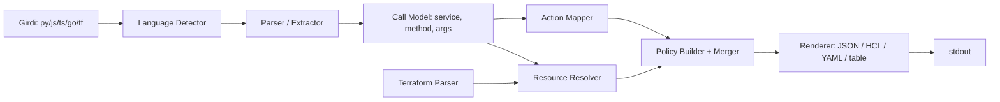

# iamforge – Proje Planı

> Kod/Terraform dosyalarını yerelde statik analizle tarayıp **least-privilege IAM policy** ve **minimal Terraform bloğu** üreten, sıfır backend'li Go CLI.

## 0. Alınan Kararlar

| # | Karar | Sonuç |
|---|---|---|
| 1 | Parser | **Saf Go** (CGO yok). tree-sitter CGO binding'i kullanılmaz. |
| 2 | İlk dil | **Python (boto3)**. Node ve Go extractor'ları sonraki faz. |
| 3 | TF varsayılan çıktı | **`aws_iam_policy_document`** (data source). `aws_iam_role_policy` sonra opsiyonel. |
| 4 | Proje adı | **iamforge** |

**Saf Go parser stratejisi** (Faz 0'da 1-2 günlük spike ile doğrulanır):

| Dil | Aday (sırayla denenir) | Not |
|---|---|---|
| Go | stdlib `go/parser`, `go/ast` | Sorunsuz |
| Python | 1) saf Go tree-sitter yeniden uygulaması (örn. `gotreesitter`) 2) tree-sitter WASM + `wazero` (CGO'suz) 3) `gpython` parser (Python 3.4 grammar; f-string/walrus/match eksik) | Spike kriteri: f-string, decorator, type hint, `async`, `match` içeren örnekleri hatasız parse etmeli |
| JS/TS | `goja/parser` (JS), TS için tree-sitter WASM/wazero | Faz 4'te karar |
| HCL | `hashicorp/hcl/v2` | Saf Go |

Parser'lar `internal/extract/<dil>` arkasında bir `Parser` arayüzüyle soyutlanır; böylece backend değişirse extractor mantığı değişmez.

## 1. Vizyon ve Kapsam

**Problem:** IAM policy elle yazılırken ya `*` ile aşırı yetki verilir ya da eksik kalır ve Lambda `AccessDenied` ile patlar.

**Çözüm:** `iamforge scan ./src` → kullanılan AWS SDK çağrıları → IAM action eşlemesi → resource ARN çıkarımı → policy JSON + Terraform HCL (stdout).

**İlkeler**
- Tek statik binary (CGO yok), ağ çağrısı yok, telemetri yok, hesap erişimi yok.
- Deterministik çıktı (aynı girdi → aynı byte'lar), CI'da diff edilebilir.
- Emin olunamayan durumda sessizce `*` üretme; **uyarı ver** ve `TODO` işaretle.

**v1 kapsam dışı:** Canlı hesap taraması, CloudTrail/Access Analyzer entegrasyonu, SaaS/dashboard, GUI.

**v2:** DynamoDB single-table tasarım üretimi (`dump2schema` kısmı) – ayrı alt komut.

## 2. CLI Tasarımı

```
iamforge scan <path...>        # Kod tara, policy üret
iamforge scan ./lambda --lang python --format tf
iamforge scan ./main.tf --role aws_iam_role.fn   # TF'deki Lambda'nın kaynak koduna bağlan
iamforge explain <action>      # örn: dynamodb:PutItem neden gerekli
iamforge version
```

| Flag | Açıklama |
|---|---|
| `--format` | `json` (varsayılan), `tf`, `yaml`, `table` |
| `--lang` | `auto`, `python` (v1), `node`, `go` (sonraki fazlar) |
| `--resource key=ARN` | Çıkarılamayan kaynak için elle ARN override |
| `--config iamforge.yaml` | Env var → kaynak eşlemesi, ignore kuralları |
| `--strict` | Çözülemeyen kaynak varsa exit code 2 |
| `--out` | Dosyaya yaz (varsayılan stdout) |

Exit code: `0` başarı, `1` hata, `2` strict ihlali / çözülemeyen kaynak.

## 3. Mimari



**Paket yapısı** (ne nerede yazılır)
```
iamforge/
  cmd/iamforge/main.go        # sadece cli.Execute() çağırır
  internal/
    cli/            # cobra komutları, flag parse, exit code
    scan/           # dosya gezme, .gitignore, dil tespiti
    extract/
      parser.go     # Parser arayüzü (backend soyutlaması)
      python/       # boto3 çıkarıcı (FAZ 1)
      node/         # AWS SDK v2/v3 çıkarıcı (FAZ 4)
      golang/       # aws-sdk-go-v2 çıkarıcı, go/ast (FAZ 4)
    model/          # Call{Service,Method,Params,Pos}, Warning, Finding
    mapping/        # method → IAM action (gömülü veri)
    resolve/        # ARN çözümleme
    tfparse/        # HCL okuma (hashicorp/hcl/v2)
    policy/         # statement oluşturma, birleştirme
    render/         # json, hcl, yaml, table
  data/             # IAM eşleme veri seti (go:embed)
  tools/genmap/     # eşleme veri setini üreten araç
  testdata/         # golden dosyalar
  docs/             # plan, ADR'ler (docs/adr/NNNN-*.md)
```

**Bağımlılık kuralı:** `model` hiçbir pakete bağımlı değildir. `extract`, `mapping`, `resolve` yalnızca `model`'e bağlıdır. `policy` → `model`. `render` → `policy`. `cli` hepsini birleştirir. Döngüsel bağımlılık yok.

**Bağımlılıklar:** `spf13/cobra`, `hashicorp/hcl/v2`, yukarıdaki saf Go parser (Faz 0 spike sonucu), `gopkg.in/yaml.v3`.

## 4. Çekirdek Teknik Konular

### 4.1 Kod analizi (extraction)

| Dil | Desen | Örnek |
|---|---|---|
| Python | `boto3.client('dynamodb')`, `boto3.resource('dynamodb').Table(x)` → değişken izleme → `.put_item(...)` | `ddb.put_item(TableName=T, Item=...)` |
| Node | v3: `new DynamoDBClient()` + `new PutItemCommand(...)` + `client.send(cmd)`; v2: `new AWS.DynamoDB().putItem()` | |
| Go | `dynamodb.NewFromConfig(cfg)` → `client.PutItem(ctx, &dynamodb.PutItemInput{TableName: ...})` | |

Adımlar:
1. AST'e parse et.
2. Import/alias tablosu çıkar (`import boto3 as b`).
3. Client/resource değişkenlerini bağla (dosya içi basit veri akışı; v1'de tek seviye fonksiyon takibi).
4. Çağrıları `Call{service, method, args}` olarak topla; sabit string / env var / değişken argümanları çöz.
5. **Dinamik çağrılar** (`getattr(client, name)`) → "çözülemedi" uyarısı.

### 4.2 Metot → IAM action eşlemesi
Naif `PutItem → dynamodb:PutItem` çoğu zaman doğru, ama istisnalar var:
- `s3.upload_file` → `s3:PutObject` (+ multipart için `s3:AbortMultipartUpload`)
- `s3.download_file` → `s3:GetObject`
- `Table.query` index ile → kaynak `table/X/index/*`
- `lambda.invoke` → `lambda:InvokeFunction`
- `sqs.send_message_batch` → `sqs:SendMessage`
- KMS ile şifreli kaynaklar → `kms:Decrypt` / `kms:GenerateDataKey` ipucu

**Veri kaynağı:** AWS Service Authorization Reference + botocore `service-2.json`. `tools/genmap` bunlardan JSON üretir, `go:embed` ile gömülür; çalışma anında ağ yok. Ek olarak elle yazılan `data/overrides.yaml`. Eşlenemeyen metot → uyarı + `unmapped` raporu, asla tahmin yok.

### 4.3 Kaynak (ARN) çözümleme – asıl değer
Öncelik:
1. Kodda sabit string → `arn:aws:dynamodb:${region}:${account}:table/orders-table`.
2. Env var (`os.environ["TABLE"]`) → Terraform'daki Lambda `environment.variables` → `aws_dynamodb_table.orders.arn` referansı.
3. `--config` / `--resource` override.
4. Çözülemezse: `var.TODO_...` placeholder + uyarı; `--strict` ile hata.

TF çıktısı mümkünse gerçek referans kullanır, hard-coded ARN değil.

### 4.4 Policy oluşturma
- Aynı kaynak için action'ları tek statement'ta grupla, alfabetik sırala.
- Resource-level izin desteklemeyen action'larda (`dynamodb:ListTables`, `sts:GetCallerIdentity`) `Resource: "*"` **gerekçeli** üret.
- Otomatik `Sid` (`DynamoDbOrdersReadWrite`).
- Condition önerileri (örn. `dynamodb:LeadingKeys`) — v1.1.
- Özet: "N action, M kaynak, K adet `*`".
- Boyut limiti uyarısı (inline 2048 / managed 6144 karakter).

### 4.5 Terraform okuma/yazma
- `hcl/v2` ile `aws_lambda_function`, `aws_iam_role`, `source_dir`/`filename`/`handler` okuyup kaynak koda bağla.
- Çıktı: **`aws_iam_policy_document`** (varsayılan, karar #3). `terraform fmt` uyumlu.
- v1 mevcut `.tf` dosyasını **değiştirmez**, sadece stdout.

## 5. Örnek

Girdi (Python):
```python
ddb = boto3.resource("dynamodb").Table(os.environ["TABLE"])
ddb.put_item(Item=item)
sqs.send_message(QueueUrl=os.environ["QUEUE_URL"], MessageBody=body)
```

Çıktı (`--format tf`):
```hcl
data "aws_iam_policy_document" "fn_orders" {
  statement {
    sid       = "DynamoDbOrdersWrite"
    actions   = ["dynamodb:PutItem"]
    resources = [aws_dynamodb_table.orders.arn]
  }
  statement {
    sid       = "SqsEventsSend"
    actions   = ["sqs:SendMessage"]
    resources = [aws_sqs_queue.events.arn]
  }
}
```

## 6. Geliştirme Sırası ve Fazlar

Genel yaklaşım: **dikey dilim önce** (Faz 1'de uçtan uca çalışan en küçük ürün), sonra genişlet. Her faz sonunda çalışan, test edilmiş, etiketlenebilir bir durum olmalı.

| Faz | Süre | Çıktı | Kabul kriteri |
|---|---|---|---|
| 0 – Temel + spike | 3-4 gün | Repo, `go mod`, cobra iskeleti, CI, lint, goreleaser iskeleti, **saf Go Python parser spike'ı + ADR-0001** | `iamforge version` çalışır, CI yeşil, `CGO_ENABLED=0` ile 3 OS'te build, spike kriterleri geçti |
| 1 – Python MVP | 1 hafta | `model`, `policy`, boto3 çıkarıcı, DynamoDB/S3/SQS/SNS mini eşleme, JSON render | `iamforge scan` Python örneklerinde golden testleri geçer |
| 2 – Eşleme veri seti | 3-4 gün | `genmap`, gömülü IAM verisi, `explain` | Tüm servislerde action seviyesinde kapsama |
| 3 – Terraform | 1 hafta | HCL parse, env→kaynak çözümleme, `tf` (policy_document) çıktısı | Örnek projede `terraform validate` geçer |
| 4 – Node & Go | 1,5 hafta | JS SDK v2/v3, aws-sdk-go-v2 çıkarıcıları (JS/TS parser kararı burada) | Dil başına ≥ 20 golden test |
| 5 – Sağlamlaştırma | 1 hafta | `--strict`, uyarı raporu, config, boyut limitleri, fuzz | ≥10 gerçek açık kaynak projede deneme |
| 6 – Yayın | 3-4 gün | goreleaser, Homebrew, Scoop, README, demo GIF | v0.1.0 |
| v2 | sonra | `iamforge table` (single-table şema), diff modu, CDK/SAM | — |

Toplam ≈ 5-6 hafta (yarı zamanlı).

### 6.1 Faz bazlı iş listesi (ne zaman, nerede, ne yazılır)

**Faz 0 – Temel**
1. `go mod init github.com/<user>/iamforge`; `cmd/iamforge/main.go`, `internal/cli` (`version` komutu, ldflags ile sürüm).
2. `.github/workflows/ci.yml` (test, `golangci-lint`, `CGO_ENABLED=0` build matrisi), `.goreleaser.yaml` iskeleti, `LICENSE`, `.gitignore`.
3. Spike: `internal/extract/python` altında 5 örnek `.py` parse eden deneme; sonucu `docs/adr/0001-parser.md`'e yaz (seçilen backend + gerekçe).
4. `internal/extract/parser.go` arayüzü.

**Faz 1 – Python MVP** (sıra önemli, alttan üste)
1. `internal/model` – `Call`, `Warning`, `Position`. Saf tipler + testler.
2. `internal/policy` – statement gruplama, sıralama, Sid üretimi. Birim testler (tablo odaklı).
3. `internal/render` – önce `json`.
4. `internal/mapping` – elle yazılmış mini `data/mini.yaml` (DynamoDB/S3/SQS/SNS).
5. `internal/extract/python` – import/alias → client bağlama → çağrı toplama. Her desen için önce `testdata/` senaryosu, sonra kod.
6. `internal/scan` – dosya gezme, ignore, dil tespiti.
7. `internal/cli` `scan` komutunu bağla; ilk uçtan uca golden test.

**Faz 2 – Eşleme veri seti**: `tools/genmap` → `data/actions.json` (embed) + `data/overrides.yaml`; `mapping` mini veriyi bırakıp gömülü veriyi okur; `explain` komutu.

**Faz 3 – Terraform**: `internal/tfparse` (lambda ↔ kaynak kod bağı, env var haritası), `internal/resolve` (env → TF referansı), `render` içine `hcl` ve `yaml`.

**Faz 4 – Node & Go**: `extract/golang` önce (stdlib, kolay), sonra `extract/node` (parser kararı ADR-0002). Aynı `model.Call` çıktısı; mapper/policy değişmez.

**Faz 5 – Sağlamlaştırma**: `--strict`, `unmapped`/uyarı raporu, `iamforge.yaml`, boyut limiti, fuzz testleri, gerçek korpus denemeleri.

**Faz 6 – Yayın**: README, goreleaser tam yapılandırma, tap/bucket, imzalama, `v0.1.0` etiketi.

### 6.2 Faz içi çalışma düzeni
- **Test-önce / golden-önce:** her yeni desen için önce `testdata/<senaryo>/input` + `expected.json`, sonra kod.
- **Faz giriş:** GitHub milestone + issue'lar (faz iş listesinden) açılır.
- **Faz çıkış (Definition of Done):** kabul kriteri sağlandı, CI yeşil, `go vet` + lint temiz, README/docs güncel, bilinen sınırlamalar `docs/limitations.md`'de, faz etiketi atıldı (`v0.0.N`).
- **Kapsam kuralı:** faz sırasında çıkan yeni fikirler issue'ya yazılır, mevcut faza eklenmez.
- **Parser riski:** Faz 1 ortasında Python parser backend'i yetersiz çıkarsa ADR güncellenir, `Parser` arayüzü sayesinde yalnızca `extract/python` etkilenir.

## 7. Git ve Commit Stratejisi

**Dal modeli (trunk-based, tek geliştirici için hafif):**
- `main` her zaman yeşil ve yayınlanabilir; doğrudan push yok (en azından PR + CI ile).
- Kısa ömürlü dallar (en fazla 1-3 gün): `feat/<alan>-<kısa-ad>`, `fix/...`, `docs/...`, `chore/...`, `test/...`, `refactor/...`.
- Faz başına uzun ömürlü dal **yok**; her faz küçük PR'lara bölünür. Yarım özellik gerekirse feature flag / kullanılmayan kod olarak merge edilir.
- Merge yöntemi: **squash merge** (PR başlığı = Conventional Commit, geçmiş doğrusal kalır).

**Commit mesajı: Conventional Commits**
```
<tür>(<kapsam>): <kısa özet, emir kipi, ≤ 72 karakter>

<neden / ayrıntı – gerekirse>
```
- Türler: `feat`, `fix`, `docs`, `test`, `refactor`, `perf`, `build`, `ci`, `chore`.
- Kapsamlar paketlerle aynı: `cli`, `scan`, `extract-python`, `extract-node`, `extract-go`, `model`, `mapping`, `resolve`, `tfparse`, `policy`, `render`, `genmap`, `data`.
- Örnekler:
  - `feat(extract-python): resolve boto3.resource Table bindings`
  - `test(policy): add golden for multi-resource merge`
  - `chore(data): regenerate IAM action map 2026-11`
- Kırıcı değişiklik: `feat(cli)!:` + `BREAKING CHANGE:` gövdesi.

**Commit boyutu / ritmi:**
- Bir commit = tek mantıksal değişiklik; kod + ilgili test aynı commit'te.
- Üretilen veri (`data/actions.json`) kod değişikliğinden **ayrı** commit.
- Golden dosya güncellemeleri (`-update`) ayrı commit veya açık mesajla; diff gözle incelenir.
- Her commit derlenebilir ve testleri geçmeli (bisect için).

**Sürümleme ve etiketler:**
- SemVer; v1 öncesi `v0.x`. Faz sonu ara etiketler: `v0.0.1` (Faz 0) … `v0.1.0` (Faz 6 yayın).
- `CHANGELOG.md` Conventional Commits'ten (goreleaser changelog) üretilir.
- Eşleme veri seti sürümü ayrı tutulur (`version` çıktısında `data: 2026-11-07`).

**Otomasyon:**
- CI (her PR): `go test ./...`, `go vet`, `golangci-lint`, `CGO_ENABLED=0` build, ağsız test.
- Opsiyonel: commit mesajı lint (commitlint veya PR başlığı kontrolü), pre-commit'te `gofmt` + `go vet`.
- Zamanlanmış CI: haftalık `genmap` çalıştır, değişiklik varsa otomatik PR aç.
- Kritik tasarım kararları `docs/adr/` altında ayrı commit'lerle belgelenir.

## 8. Test Stratejisi
- **Golden testler:** `testdata/<senaryo>/{input, expected.json, expected.tf}`, `-update` flag'i.
- **Birim:** extractor, mapper, resolver ayrı.
- **Doğrulama:** Policy'yi `aws iam simulate-custom-policy` ile opsiyonel/manuel kontrol (CI dışı).
- **Gerçek korpus:** AWS serverless örnekleriyle regresyon.
- **Fuzz:** Bozuk girdide panik olmamalı.
- En kritik metrik: false-negative (eksik action); sonra false-positive (fazla yetki).

## 9. Riskler

| Risk | Önlem |
|---|---|
| Statik analiz dinamik kodu göremez → eksik yetki | Uyarı raporu, `--strict`, "çözülemedi" listesi, "doğrulayın" notu |
| Saf Go Python parser eksik/yetersiz olabilir (modern sözdizimi) | Faz 0 spike + `Parser` arayüzü; yedek: tree-sitter WASM + wazero |
| IAM eşlemesi eskir | `genmap` periyodik CI job'u, veri seti sürümü `version` çıktısında |
| Yanlış güven hissi | Çıktı başlığında uyarı; `*` asla sessiz üretilmez |
| Wrapper fonksiyonlar çağrıyı gizler | v1 tek seviye takip; v2 paket-ötesi çağrı grafı |

## 10. Dağıtım ve Lisans
- MIT veya Apache-2.0 (Faz 0'da seçilir).
- goreleaser: linux/mac/windows × amd64/arm64 (CGO'suz olduğu için basit cross-compile); checksum + cosign imza.
- Homebrew tap, Scoop bucket, `go install`.
- Ağ yok garantisi: CI'da ağsız sandbox'ta test.

## 11. İlk Adımlar
1. `go mod init`, cobra iskeleti, CI (Faz 0).
2. Saf Go Python parser spike'ı → ADR-0001.
3. `model` ve `policy` paketinin saf mantığı + testler.
4. Python extractor için 10 küçük `testdata` örneği.
5. DynamoDB/S3/SQS mini eşlemesiyle ilk uçtan uca `scan` → JSON.
6. README taslağı: problem, örnek, sınırlamalar.

## 12. Açık Kararlar
- Saf Go Python parser backend'i: spike sonucuna göre (ADR-0001).
- JS/TS parser: Faz 4'te (ADR-0002).
- Lisans: MIT mi Apache-2.0 mı?
- `iamforge` adı için GitHub/paket yöneticisi çakışma kontrolü (isim seçildi, kontrol kaldı).
